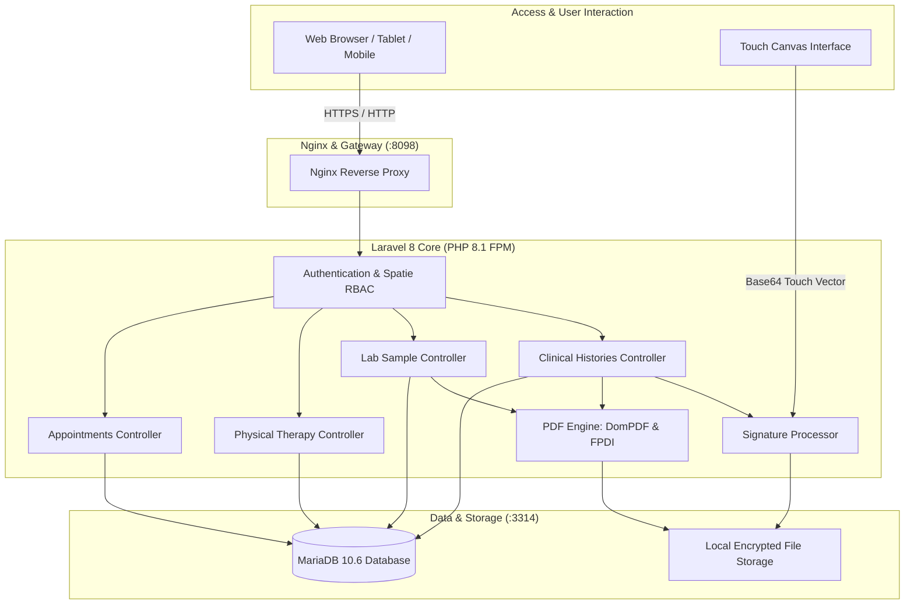

# Zerbit EHR - Enterprise HealthTech & Clinical Management Platform

[](https://www.php.net/)
[](https://laravel.com/)
[](https://mariadb.org/)
[](https://www.docker.com/)
[](https://github.com/barryvdh/laravel-dompdf)
[](https://spatie.be/docs/laravel-permission)
[](LICENSE)

An enterprise-grade Electronic Health Records (EHR) and clinical operation platform architected for outpatient clinics, diagnostic laboratories, physical therapy centers, and multi-specialty medical practices. Zerbit provides an end-to-end digital clinical workflow, encompassing patient intake, medical history records (CIE-10), biometric touch signatures for informed consent, clinical laboratory sample tracking with automated PDF reporting, and kinesiology rehabilitation progress tracking.

---

## Key Capabilities

- **Electronic Health Records (EHR / Historia Clinica):** Structured clinical encounters covering triage vitals, past medical histories (pathological, surgical, allergic, pharmacological, family), physical examination, CIE-10 diagnostic coding, and customized therapeutic plans.
- **Biometric Canvas Digital Signatures:** In-browser touch and stylus signature capture via HTML5 canvas, converting vector strokes into cryptographic base64 payloads embedded into official clinical histories, consent waivers, and lab deliveries.
- **Clinical Laboratory Sample Tracking:** Sample intake pipeline tracking statuses (`Ingresado`, `En Analisis`, `Validado`, `Completado`), automated authorization verification, and instant high-fidelity PDF report generation using DomPDF and FPDI.
- **Physical Therapy & Kinesiology Module:** Tailored treatment session tracking, joint mobility assessments, rehabilitation objectives, and longitudinal progress metrics.
- **Medical Appointment Scheduling:** Integrated calendar and appointment management connecting patients, attending physicians, and clinical rooms with state lifecycle transitions (`Pendiente`, `Confirmada`, `Atendida`, `Cancelada`).
- **Role-Based Access Control (RBAC):** Powered by `spatie/laravel-permission` with strictly segregated roles: `admin`, `doctor`, `therapist`, and `patient`.
- **Full Containerization:** Dockerfile and Docker Compose orchestration pairing PHP 8.1 FPM, Nginx, MariaDB 10.6, phpMyAdmin, and Mailpit for automated local development and testing.

---

## Architectural Workflow



---

## Domain Architecture & Core Modules

### 1. Electronic Health Records (EHR)
The clinical history engine satisfies outpatient documentation standards:
- **Demographics & Master Patient Index:** Unified identification (CC, TI, RC, CE, Passport), emergency contacts, blood type, and insurance carrier.
- **Consultation Motive & Anamnesis:** Systematic symptom inquiry and chronological present illness narrative.
- **Diagnostic Codification:** Standardization against International Classification of Diseases (CIE-10 / ICD-10).
- **Longitudinal Evolution:** Dynamic progress notes (`ChEvolution`) and psychotherapeutic assessments (`ChPsychotherapeuticAssessment`) linked to the master clinical record.

### 2. Clinical Laboratory & Diagnostics
- Tracks specimens from phlebotomy and collection to validation.
- Validates doctor authorizations, test categories, and biochemical reference ranges.
- Compiles official PDF lab result sheets stamped with the clinical laboratory director's digital signature.

### 3. Physical Therapy & Rehabilitation
- Captures initial functional impairment, range of motion (ROM), pain scales (VAS), and target rehabilitation milestones.
- Tracks recurring sessions (`PhysicalTherapy`) with exercises, modalities (electrotherapy, ultrasound, thermotherapy), and patient tolerance.

### 4. Touch Digital Signatures
- Implements an interactive canvas where physicians, specialists, and patients sign directly from tablets, touchscreens, or trackpads.
- Securely stores signatures as base64-encoded PNG vectors with audit timestamps, rendering them into indelible PDF consultation summaries.

---

## Tech Stack

| Layer | Technology | Purpose |
| :--- | :--- | :--- |
| **Backend Framework** | Laravel 8.12 | RESTful routing, Eloquent ORM, request validation, service container |
| **Runtime** | PHP 8.1 FPM | High-performance scripting runtime on Alpine Linux |
| **Database** | MariaDB 10.6 | Relational storage with strict foreign keys and index optimization |
| **Web Server** | Nginx Alpine | Fast static file delivery, HTTP request proxying, buffering |
| **Security & RBAC** | Spatie Laravel-Permission | Fine-grained roles (`admin`, `doctor`, `therapist`, `patient`) |
| **PDF Generation** | DomPDF 0.9 + FPDI 2.3 | Programmatic rendering of clinical dossiers and signed laboratory deliverables |
| **Frontend UI** | Blade + Bootstrap 4 + jQuery | Responsive clinical portal, modal dialogs, and signature canvas |
| **Email Testing** | Mailpit | Local SMTP catch-all server with responsive web inspection |
| **Database GUI** | phpMyAdmin | Visual database inspection and management |

---

## Database Relational Architecture

The system coordinates 17 relational database migrations:

- `users`: Medical practitioners, administrators, and allied health staff.
- `roles`, `permissions`, `model_has_roles`: Spatie role-based authorization matrix.
- `patients`: Master patient records with document types, contact information, and medical background.
- `clinical_histories`: Root clinical encounter records.
- `ch_records`: Detailed clinical assessment sub-records.
- `ch_evolutions`: Sequential follow-up consultations and treatment progress notes.
- `ch_psychotherapeutic_assessments`: Mental health evaluations, psychological history, and behavioral plans.
- `lab_samples`: Clinical diagnostic specimens, test parameters, and authorization states.
- `physical_therapies`: Physical therapy and kinesiology rehabilitation sessions.
- `appointments`: Scheduled clinical visits with doctor, date, and status associations.
- `signatures`: Digital signature registry with polymorphic document links.

---

## Quick Start with Docker Compose

### Prerequisites
- Docker Engine 20.10+
- Docker Compose 2.0+

### 1. Clone the Repository
```bash
git clone git@github.com-personal:KevinAndrey96/zerbit.git
cd zerbit
```

### 2. Environment Configuration
Copy the sanitized environment template:
```bash
cp .env.example .env
```

### 3. Launch the Platform
Build and spin up the multi-container stack:
```bash
docker-compose up -d --build
```

The container entrypoint will automatically:
1. Wait for MariaDB to become ready and healthy.
2. Generate an application key (`APP_KEY`) if absent.
3. Run all database migrations (`php artisan migrate --force`).
4. Seed the database with realistic healthcare practitioners, patients, clinical histories, lab samples, and appointments (`php artisan db:seed --force`).
5. Create the public storage symlink (`php artisan storage:link`).
6. Launch PHP-FPM and Nginx.

### 4. Access URLs & Services

| Service | URL | Default Port | Description |
| :--- | :--- | :--- | :--- |
| **Zerbit Web App** | [http://localhost:8098](http://localhost:8098) | `8098` | Main clinical portal and EHR interface |
| **phpMyAdmin** | [http://localhost:8099](http://localhost:8099) | `8099` | Database visual administration |
| **Mailpit Web UI** | [http://localhost:8027](http://localhost:8027) | `8027` | Local email testing and previewing |
| **MariaDB** | `localhost:3314` | `3314` | Direct relational database connection |

---

## Default Demonstration Credentials

The automated seeder populates realistic clinical demo accounts:

| Role | Email | Password | Assigned Practitioner |
| :--- | :--- | :--- | :--- |
| **Administrator** | `admin@zerbit.health` | `password` | Dr. Alejandro Restrepo (Medical Director) |
| **Doctor / Specialist** | `doctor@zerbit.health` | `password` | Dra. Camila Torres (General Medicine) |
| **Physical Therapist** | `therapist@zerbit.health` | `password` | Lic. Sebastian Ramirez (Kinesiologist) |
| **Patient** | `patient@zerbit.health` | `password` | Carlos Mendoza (Demo Patient) |

---

## Clinical Safety & Regulatory Guidelines

- **Informed Consent & Audit Trail:** Every clinical action, evolution note, and digital signature records creation timestamps, physician identifiers, and patient confirmation.
- **Zero Raw Credentials Policy:** All default database credentials and API secrets have been sanitized from version control. Sensitive operational configuration must be injected via runtime environment variables.
- **Isolated Health Data Storage:** Generated laboratory PDFs and biometric vectors are stored in segregated, non-executable storage volumes with access restricted via application-level authentication.

---

## Author & Engineering Credits

- **Architecture & Engineering:** [Kevin Andrey Herrera Silva](https://github.com/KevinAndrey96)
- **Primary Contact:** [kahs_kevin@hotmail.com](mailto:kahs_kevin@hotmail.com)
- **Portfolio Showcase:** [KevinAndrey96](https://github.com/KevinAndrey96)

---

## License

This software is released under the [MIT License](LICENSE).
