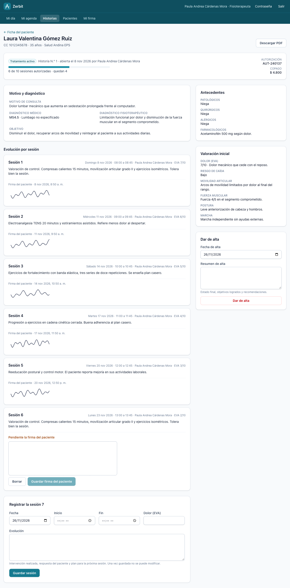
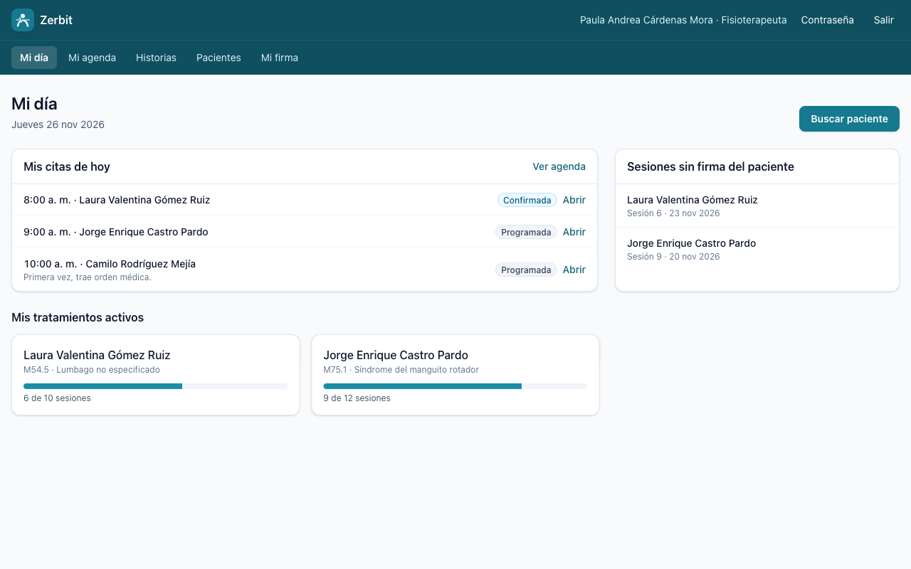
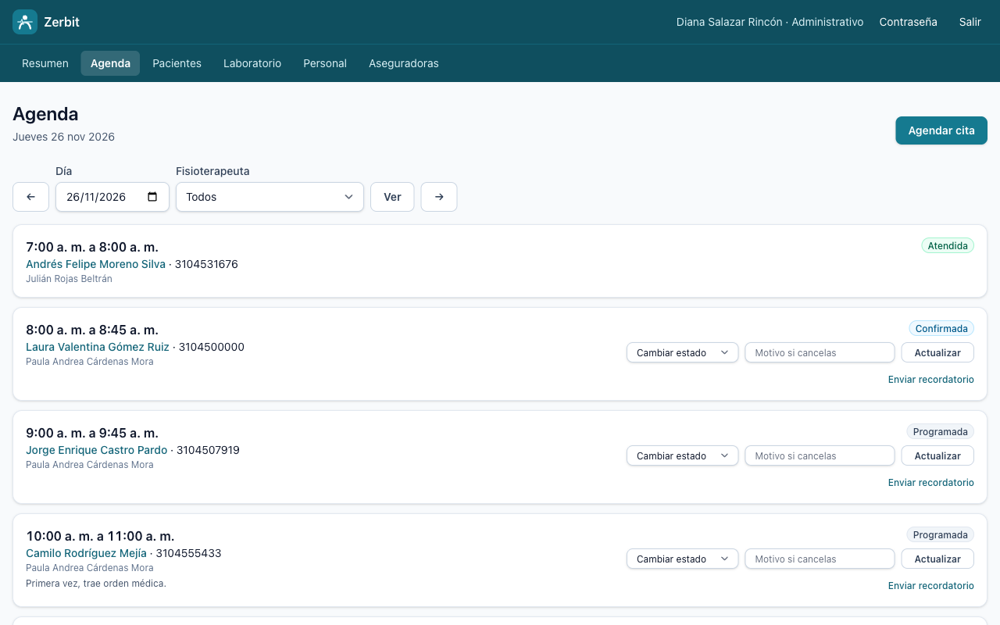
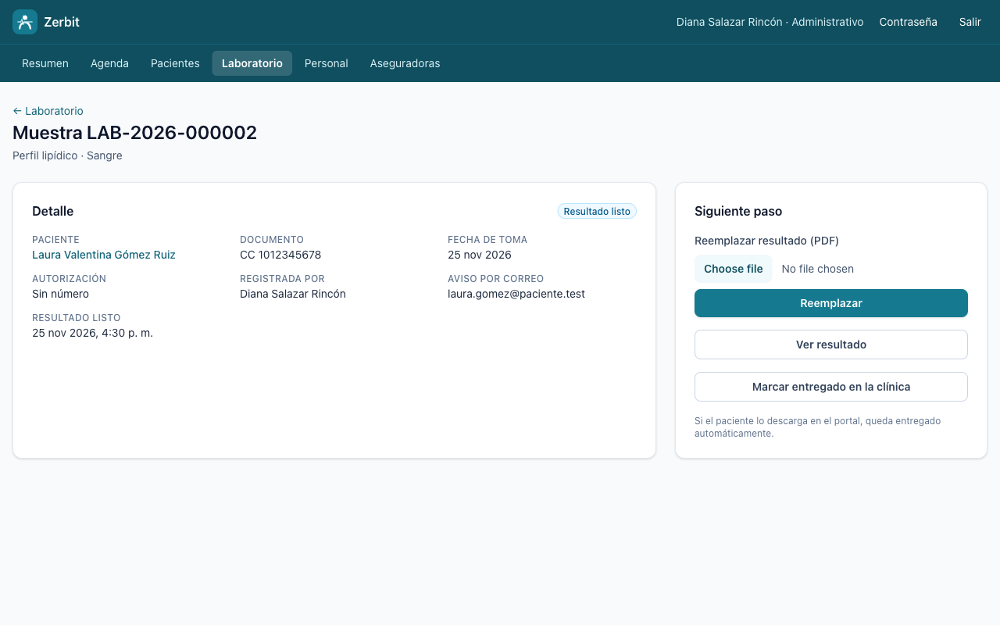
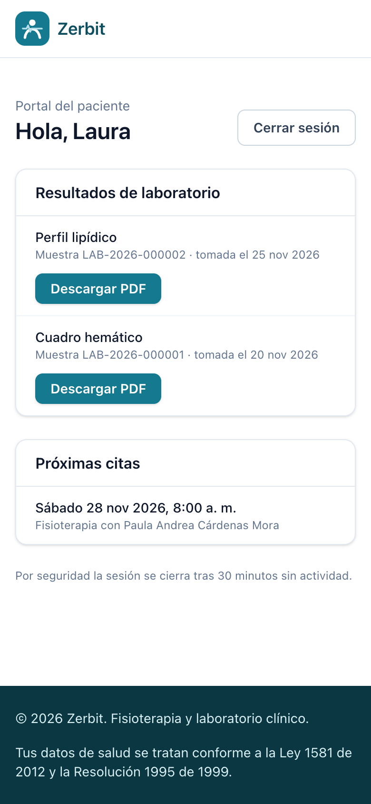
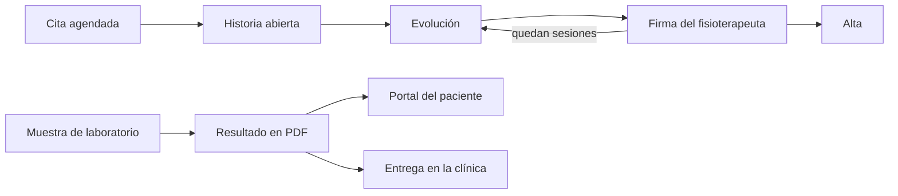

# Historia clínica electrónica en Laravel para fisioterapia y laboratorio clínico

[](https://github.com/KevinAndrey96/laravel-zerbit-ehr-clinical-platform/actions/workflows/ci.yml)


**Zerbit es una plataforma de historia clínica electrónica (HCE) para una IPS de fisioterapia con laboratorio clínico**, hecha con Laravel 13, MariaDB y Tailwind CSS. Los fisioterapeutas abren la historia, registran y **firman cada sesión** desde el navegador y descargan la historia en PDF. La recepción agenda citas, envía recordatorios y sube los resultados de laboratorio. Los pacientes descargan sus resultados en un portal al que entran con un enlace de un solo uso enviado a su correo.



## Qué hace

- **Historia clínica de fisioterapia:** motivo de consulta, antecedentes, diagnóstico con **código CIE-10 validado**, objetivos, plan y número de sesiones autorizadas por la aseguradora. Cada paciente tiene a lo sumo un tratamiento abierto.
- **Evoluciones firmadas:** cada sesión queda numerada y no puede exceder lo autorizado. El fisioterapeuta firma con el dedo o el mouse sobre un lienzo, y una sesión firmada no se modifica. La historia se cierra con un **alta** que no puede ser anterior a la última sesión.
- **PDF de la historia** con los datos del paciente, el diagnóstico, todas las evoluciones y sus firmas, generado con DomPDF.
- **Registro de accesos:** cada consulta, descarga, apertura, evolución, firma y alta queda auditada con usuario, IP y fecha. El administrativo ve el registro de cada paciente.
- **Agenda:** citas de 30, 45 o 60 minutos en horario de atención, sin cruces para el fisioterapeuta ni para el paciente (con bloqueo de fila). Estados programada, confirmada, atendida, inasistencia y cancelada con motivo. La asistencia solo se registra cuando llega la hora.
- **Recordatorios por correo:** manuales desde la agenda y automáticos todos los días a las 5:00 p. m. para las citas del día siguiente.
- **Laboratorio:** muestra con código `LAB-2026-000001`, análisis, resultado en PDF y entrega en la clínica o por el portal. Si el paciente lo pidió, recibe un aviso por correo cuando el resultado está listo.
- **Portal del paciente:** el paciente escribe su documento y su correo y recibe un enlace firmado que vence en 20 minutos. Dentro ve sus resultados y sus próximas citas. La sesión se cierra tras 30 minutos sin actividad.
- **Administración:** personal con roles, aseguradoras (EPS, prepagadas, ARL) con **NIT validado con el dígito de verificación de la DIAN** y pacientes con tipo de documento colombiano.
- **Diseño adaptable:** el portal y las tablas funcionan en el celular.

| Panel del fisioterapeuta | Agenda |
| :---: | :---: |
|  |  |

| Laboratorio | Portal del paciente en el celular |
| :---: | :---: |
|  |  |

## Roles y permisos

| Rol | Puede |
| :--- | :--- |
| **Fisioterapeuta** | Abrir historias, registrar y firmar evoluciones, dar de alta, descargar el PDF y ver su agenda. Solo quien atiende el tratamiento edita la historia, y solo antes de la primera sesión. |
| **Administrativo** | Gestionar pacientes, agenda, recordatorios, laboratorio, personal y aseguradoras, y consultar el registro de accesos. **No lee historias clínicas.** |
| **Paciente** | Entrar al portal con un enlace enviado a su correo, descargar sus resultados y ver sus citas. |

La reserva de la historia clínica separa a quien atiende de quien administra: las reglas viven en *policies* (`ClinicalHistoryPolicy`, `EvolutionPolicy`, `AppointmentPolicy`) y en un middleware de rol. Las rutas anidadas usan *scoped bindings*, de modo que una evolución de otra historia responde 404. No existen rutas para borrar historias, evoluciones ni resultados.

## Seguridad

| Riesgo | Medida |
| :--- | :--- |
| Acceso a datos de otros pacientes (IDOR) | Autorización por rol y por fisioterapeuta tratante en cada ruta. Los resultados se sirven desde un disco privado tras verificar la sesión, nunca desde una URL pública. |
| Suplantación en el portal | Enlace firmado de 20 minutos enviado al correo registrado. La respuesta es la misma exista o no el paciente, y se limita a 5 solicitudes por minuto por IP y 5 por hora por documento. |
| Firmas alteradas | La firma se valida como PNG real de máximo 200 KB, se guarda en el disco privado y una sesión firmada no se vuelve a firmar ni se edita. |
| Datos inconsistentes | Sesiones dentro de lo autorizado, alta no anterior a la última sesión, citas sin cruces con bloqueo de fila y transiciones de estado validadas. |
| Fuerza bruta | 5 intentos por correo e IP y 20 por minuto por IP; mensaje genérico ante credenciales erradas. |
| Subidas maliciosas | Solo PDF de máximo 10 MB con nombre aleatorio en el disco privado; el resultado anterior se borra al reemplazarlo. |
| XSS y clickjacking | Escape de Blade, Content Security Policy sin scripts ni estilos en línea, `X-Frame-Options: DENY`, `nosniff`, `Referrer-Policy` y `Permissions-Policy`. |
| Caché de datos de salud | `Cache-Control: no-store` en toda respuesta autenticada y en el portal; sesión cifrada. |
| Secretos | Ninguna credencial en el repositorio: `APP_KEY`, la contraseña de la base de datos y la de las cuentas demo se generan con `make env`. |

## Arquitectura

```text
app/
├── Domain/
│   ├── Clinical/      Edad, código CIE-10 y plan de sesiones (sin Eloquent)
│   ├── Scheduling/    Franja horaria y cruces de citas
│   ├── Signature/     Validación de la imagen de la firma
│   └── Tax/           NIT colombiano con dígito de verificación
├── Actions/           Casos de uso transaccionales: abrir historia, evolucionar, firmar, alta, agendar, laboratorio
├── Policies/          Reglas de acceso por rol, tratante y estado de la historia
├── Mail/              Recordatorio de cita, resultado listo y enlace del portal
├── Http/
│   ├── Controllers/   Personal clínico, administración y portal del paciente
│   ├── Requests/      Validación con mensajes en español
│   └── Middleware/    Rol, sesión del portal y cabeceras de seguridad
├── Models/            Eloquent con relaciones, casts y conteos precargados
└── Support/           Auditoría de accesos, archivos privados y formato colombiano
```



El plan de sesiones (`SessionPlan`), el código CIE-10 y la franja horaria (`TimeSlot`) son objetos de dominio puros, probados sin base de datos. Cada acción corre en una transacción con bloqueo de fila para que dos peticiones simultáneas no dupliquen una sesión ni crucen una cita.

## Puesta en marcha local

Requisitos: Docker y `make`.

```bash
make up    # crea .env con secretos aleatorios, construye la imagen y levanta la app con MariaDB 11.8 y Mailpit
make e2e   # prueba de humo contra el entorno levantado
```

Abre <http://localhost:8080>. Los correos (recordatorios, resultados y enlaces del portal) llegan a Mailpit en <http://localhost:8025>. El arranque carga una clínica demo con pacientes, historias, citas y resultados ficticios:

| Cuenta | Rol |
| :--- | :--- |
| `recepcion@zerbit.test` | Administrativo |
| `fisioterapia@zerbit.test` | Fisioterapeuta |

La contraseña de ambas es el valor de `DEMO_PASSWORD` en tu `.env` (`make env` la muestra al crearlo). Para el portal usa la cédula `1012345678` con el correo `laura.gomez@paciente.test` y abre el enlace que llega a Mailpit.

## Despliegue

La imagen `runtime` corre Apache como `www-data` en el puerto 8080, expone `/up` para el balanceador y en cada arranque aplica migraciones y el catálogo de aseguradoras. El contenedor `scheduler` ejecuta `schedule:work` para los recordatorios diarios. Variables principales:

| Variable | Obligatoria | Descripción |
| :--- | :---: | :--- |
| `APP_KEY` | Sí | Clave de cifrado de Laravel (`base64:` + 32 bytes). |
| `APP_URL` | Sí | URL pública; se usa en los enlaces firmados del portal. |
| `DB_HOST`, `DB_DATABASE`, `DB_USERNAME`, `DB_PASSWORD` | Sí | Conexión a MariaDB o MySQL. |
| `MAIL_MAILER`, `MAIL_HOST`, `MAIL_PORT`, `MAIL_USERNAME`, `MAIL_PASSWORD` | Sí | Servidor SMTP para recordatorios, resultados y enlaces. |
| `MAIL_FROM_ADDRESS` | Sí | Remitente de los correos. |
| `SEED_DEMO` | No | `true` carga la clínica demo; déjalo en `false` en producción. |
| `APP_TRUST_PROXIES` | No | `true` solo detrás de un proxy que termine TLS. |
| `SESSION_SECURE_COOKIE` | No | `true` cuando el sitio se sirve por HTTPS. |
| `APP_TIMEZONE` | No | Zona horaria de la agenda; por defecto `America/Bogota`. |

Los resultados y las firmas se guardan en `storage/app/private`, montado como volumen en `docker-compose.yml`. Respáldalo junto con la base de datos.

## Pruebas y calidad

```bash
make test    # PHPUnit dentro de la imagen de pruebas
make check   # Pint, Larastan nivel 8 y PHPUnit
```

- **153 pruebas** unitarias y de integración: CIE-10, edad, plan de sesiones, franjas horarias, firma, NIT de la DIAN, formato colombiano, ingreso y bloqueo, separación de roles en cada ruta clínica, historia completa (apertura, evoluciones, firma, alta y PDF), auditoría, agenda con cruces y recordatorios, laboratorio, portal con enlace firmado y vencimiento, administración y cabeceras de seguridad.
- **Prueba de extremo a extremo** en CI con Docker Compose, MariaDB y Mailpit reales: ingreso con token CSRF, historia y PDF, bloqueo de la historia para el administrativo y portal del paciente con el enlace capturado del correo.
- CI en PHP 8.4 y 8.5; Dependabot para Composer, npm, Docker y GitHub Actions.

## Historia del proyecto

La primera versión (2021) fue una aplicación Laravel 8 con Vue hecha para una IPS de fisioterapia y laboratorio. En 2026 la audité y encontré problemas serios: resultados de laboratorio accesibles sin sesión en una URL fija con id consecutivo, rutas de firma y de registro de pacientes sin autenticación, una ruta pública para limpiar la caché, un `upload.php` suelto, credenciales de hosting en el repositorio, PDF y firmas de pacientes versionados y una licencia MIT que no correspondía a un trabajo para un cliente.

Purgué del historial los datos de pacientes, las credenciales y los archivos de terceros, y reescribí la plataforma desde cero en Laravel 13 con reserva de la historia por rol, firmas validadas, auditoría de accesos, portal con enlaces firmados, pruebas automatizadas y despliegue en contenedores. Todos los datos de la demo son ficticios. La versión original queda en la etiqueta `v0.1-legacy` como referencia, sin la información purgada.

## Autor

**Kevin Andrey Herrera Silva**, desarrollador backend. [GitHub](https://github.com/KevinAndrey96)

## Licencia

Sin licencia de código abierto. El proyecto nació como trabajo para un cliente y se publica como muestra de portafolio: todos los derechos reservados.
